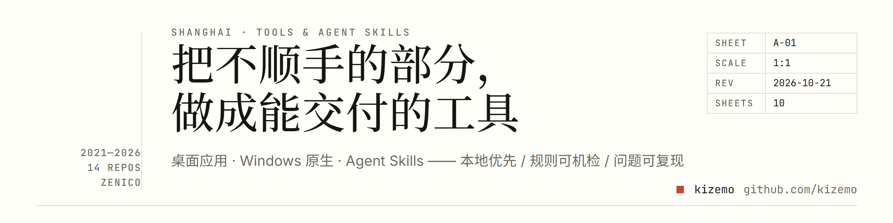
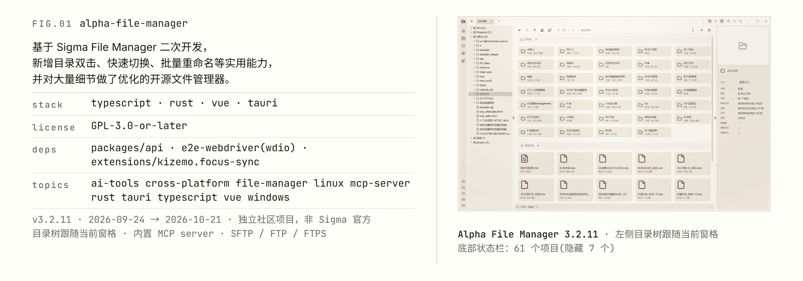
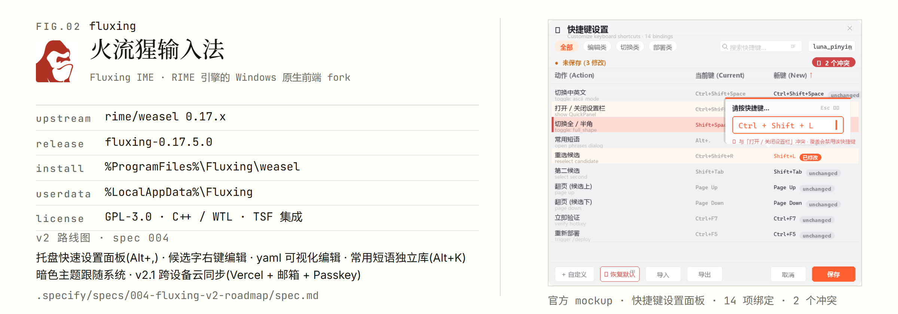
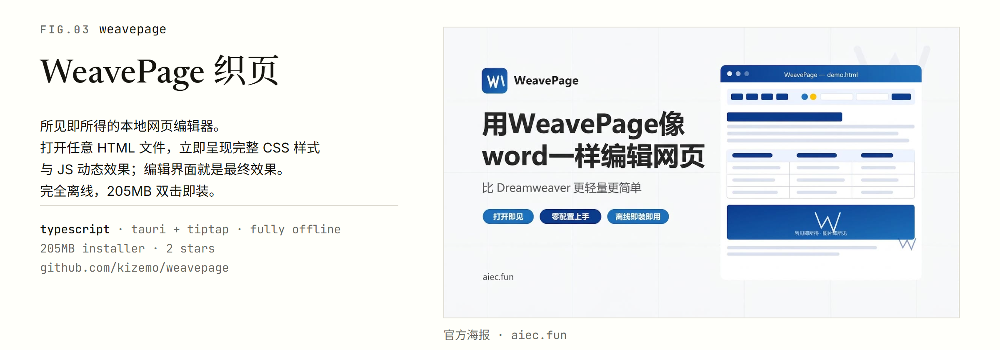
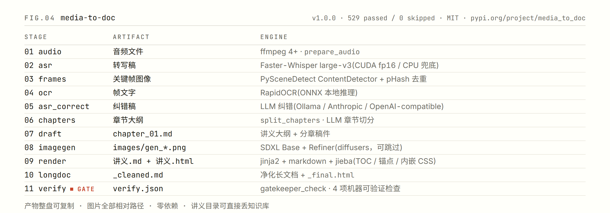

  

  
  
  
  
  

**把不顺手的部分，做成能交付的工具。** 一个持续学习者、工具制造者：开发桌面应用、Windows 原生程序，并沉淀 AI 落地经验为可复用的 Agent Skill。

坚守原则：**本地优先 · 规则可机检 · 问题可复现**

---

## 精选项目

### FIG.01 · [alpha-file-manager](https://github.com/kizemo/alpha-file-manager)

基于 Sigma File Manager 二次开发的开源文件管理器。

- 技术栈：**Tauri 2 + Rust + Vue 3 + TypeScript**
- 目录双击直达、快速切换、批量重命名——把文件管理里最不顺手的手感重做一遍
- 内置 **MCP server**，文件操作可以直接交给 Agent

  

### FIG.02 · [fluxing 火流猩输入法](https://github.com/kizemo/fluxing)

RIME 引擎的 Windows 原生前端 fork（**C++ / WTL / TSF**，GPL-3.0）。

- 品牌化改造 + 用户数据隔离，装完即用
- 预装 rime_ice 与八股文数据
- v2 路线图：跨设备云同步、候选字右键编辑

  

### FIG.03 · [weavepage 织页](https://github.com/kizemo/weavepage)

所见即所得的本地网页编辑器（**Tauri + Tiptap**）。

- 打开任意 HTML 即呈现完整 CSS 与 JS 效果——编辑界面即最终效果
- 完全离线，205 MB 双击即装

  

### FIG.04 · [media-to-doc](https://github.com/kizemo/media-to-doc)

把本地音视频一键转化为带 AI 配图、可独立分发的 Markdown + HTML 讲义。

- **11 阶段流水线**：audio → asr → frames → ocr → asr_correct → chapters → draft → imagegen → render → longdoc → verify
- 本地优先（Ollama + Faster-Whisper + SDXL），LLM 可插拔
- Python API + CLI + MCP server，已发布 PyPI（`media_to_doc`）

  

---

## Agent Skills

把 AI 落地经验固化成可机检的契约，不是玩具 demo：

| Skill | 内容 | 协议 |
|---|---|---|
| **sql-skill** | 企业 PostgreSQL 视角的通用 SQL 专业度 Skill：10 章 + 4 辅助文件，4 通道动态同步 + gbrain 语义召回 + 全文检索双模式 | MIT |
| **evidence-skill** | Evidence BI 生产切换经验蒸馏：5 个 Critical Bug + nginx patch + postgres_fdw 跨库 | MIT |
| **skill-forge** | 造 Skill 的元技能，6 阶段 audit→scope→bootstrap→forward→verify→materialize；确定性 + LLM 评分双门禁，SHA 基线竞态检查 | 未声明 |
| **loop-engineering** | 把 Agent 持续运行当软件工程问题解：5 hook + 3 helper + 1 test + 1 README；危险操作必须人工拍板，冲突 fail-closed | Apache-2.0 |

---

## 做工具的人

日常某个环节不顺手，就自己造一个工具；工具要**本地优先、规则可机检、问题可复现**；做完沉淀成别人能直接用的东西。

这不是四件无关的事，是同一件事的**四次重演**：

1. **桌面应用**（`alpha-file-manager`、`weavepage`）—— 操作系统那一层不顺手
2. **Windows 原生**（`fluxing`）—— 输入法那一层不顺手
3. **音视频流水线**（`media-to-doc`、`ad-cut`、`long-doc-processor`）—— 内容加工那一层不顺手
4. **Agent Skills**（`sql-skill`、`evidence-skill`、`skill-forge`、`loop-engineering`）—— 让 AI 别再犯同样的错

最后一条最特别：这些 skill 是把**生产事故**（nginx patch、postgres_fdw 跨库、postmortem）固化成**可机检的契约**。

---

## 仓库索引

全部 14 个公开仓库（[查看全部 →](https://github.com/kizemo?tab=repositories)）：

| 仓库 | 语言 | 一句话 |
|---|---|---|
| [alpha-file-manager](https://github.com/kizemo/alpha-file-manager) | TypeScript | 基于 Sigma File Manager 二次开发的开源文件管理器 |
| [fluxing](https://github.com/kizemo/fluxing) | C++ | RIME 引擎的 Windows 原生前端 fork |
| [weavepage](https://github.com/kizemo/weavepage) | TypeScript | 所见即所得的本地网页编辑器 |
| [media-to-doc](https://github.com/kizemo/media-to-doc) | Python | 音视频一键转讲义 |
| [sql-skill](https://github.com/kizemo/sql-skill) | HTML | 企业 PostgreSQL 视角的通用 SQL 专业度 Skill |
| [evidence-skill](https://github.com/kizemo/evidence-skill) | — | Evidence BI 生产切换经验蒸馏 |
| [skill-forge](https://github.com/kizemo/skill-forge) | Python | 六阶段元技能 |
| [long-doc-processor](https://github.com/kizemo/long-doc-processor) | Python | 异构输入转可独立打开的 HTML 讲义（30 条规约可机检 · 531 tests passed） |
| [ad-cut](https://github.com/kizemo/ad-cut) | Python | 剪掉课程录像里的赞助口播 |
| [loop-engineering](https://github.com/kizemo/loop-engineering) | Shell | 把 Agent 持续运行当软件工程问题解 |
| [shgb-keepalive](https://github.com/kizemo/shgb-keepalive) | JavaScript | Playwright + Edge CDP |
| [focus-sync](https://github.com/kizemo/focus-sync) | PowerShell | Sigma File Manager 插件 |
| [media-to-doc-ui](https://github.com/kizemo/media-to-doc-ui) | Rust | Tauri 2 桌面外壳 |
| [kizemo](https://github.com/kizemo/kizemo) | — | 本仓库（主页） |

---

## 协议与统计

| 维度 | 数据 |
|---|---|
| 公开仓库 | 14 个（本页精选呈现 4 个） |
| 协议分布 | GPL-3.0 ×1 · MIT ×4 · NOASSERTION ×5 · 无声明 ×4 |
| 语言谱 | TypeScript · Rust · C++ · Python · PowerShell · JavaScript · Shell · HTML |
| 技术栈 | Tauri · Rust · Vue · React · Tiptap · RIME / weasel · WTL · TSF · Playwright · Edge CDP · MCP server · ffmpeg · faster-whisper · Ollama · SDXL · RapidOCR · Postgres FDW |
| 发布物 | 1 个 PyPI 包（`media_to_doc`）· 2 个 MCP server（`alpha-file-manager`、`media-to-doc`） |
| 产出 | 2021-10 起持续产出 |

  kizemo · github.com/kizemo · 持续学习 · 工具制造 · 可复用的契约

